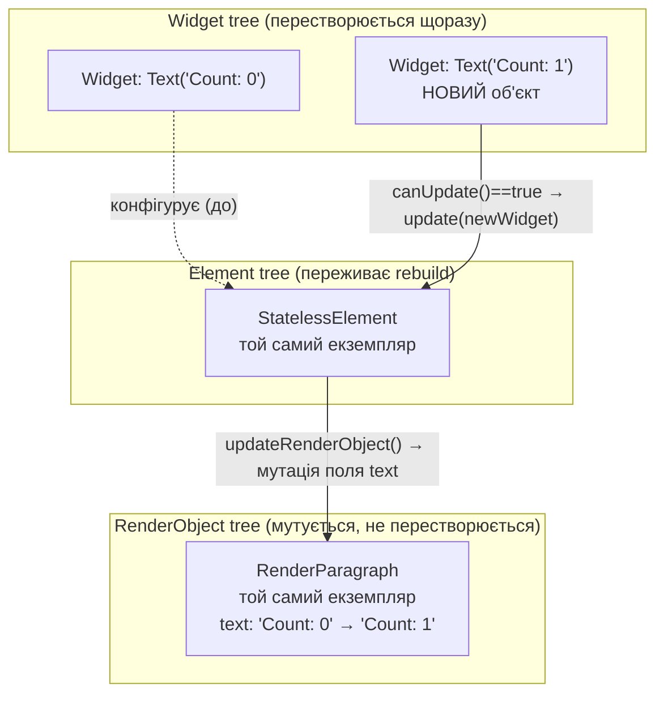
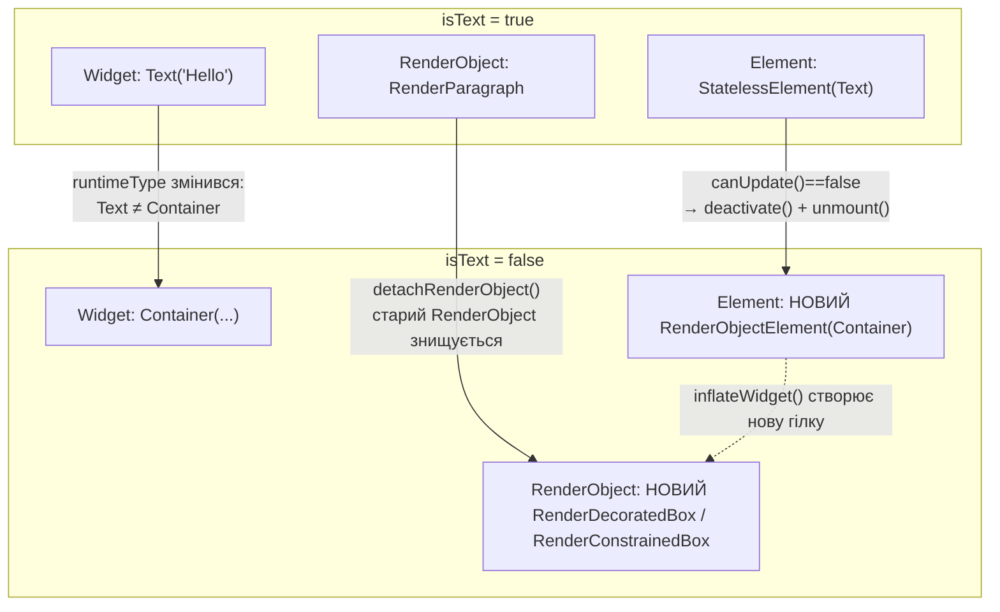

# Практична робота 2: Технологія Flutter

**Дисципліна:** Програмування для мобільних платформ
**Тема:** Технологія Flutter
**Варіант 1:** Три дерева Flutter

## Мета роботи

З'ясувати на конкретному прикладі, що відбувається з деревами Widget, Element та
RenderObject під час перебудови (rebuild), і сформулювати правило, за яким Flutter
вирішує, перевикористовувати Element/RenderObject чи створювати їх заново.

---

## 1. Три дерева: коротко про механізм

Flutter одночасно підтримує три паралельні структури даних:

- **Widget tree** — незмінний (immutable) опис конфігурації UI. Кожен виклик `build()`
  створює нові об'єкти `Widget`; старі просто відкидаються (garbage collection).
- **Element tree** — мутабельний "керуючий" шар. Element — це інстанційований, живий
  вузол дерева, який зберігає позицію в ієрархії, посилання на поточний Widget і на
  відповідний RenderObject. Element не перестворюється при кожному rebuild — він
  оновлюється методом `update(newWidget)`.
- **RenderObject tree** — шар, що відповідає за layout, painting і hit-testing. Це
  найважчі об'єкти (зберігають розміри, constraints, зв'язки з `RenderBox` тощо), тому
  Flutter намагається їх мутувати, а не перестворювати.

Ключовий механізм узгодження (reconciliation) — статичний метод
`Widget.canUpdate(oldWidget, newWidget)`, який повертає `true`, якщо `runtimeType` і
`key` обох віджетів збігаються. Якщо `true` — Element викликає `update()` і передає
новий Widget у той самий RenderObject через `updateRenderObject()`. Якщо `false` —
старий Element деактивується (`unmount()`), а новий Element і RenderObject
створюються з нуля.

---

## 2. Приклад 1: setState() змінює лише текст

```dart
class CounterText extends StatefulWidget {
  const CounterText({super.key});
  @override
  State<CounterText> createState() => _CounterTextState();
}

class _CounterTextState extends State<CounterText> {
  int _count = 0;

  void _increment() => setState(() => _count++);

  @override
  Widget build(BuildContext context) {
    return Column(
      children: [
        Text('Count: $_count'),
        ElevatedButton(onPressed: _increment, child: const Text('+')),
      ],
    );
  }
}
```

При натисканні кнопки `setState()` позначає `_CounterTextState` як "брудний" (dirty),
і Flutter повторно викликає `build()`. Метод `build()` повертає **новий** об'єкт
`Text('Count: 1')` — це новий Widget. Але:

- `runtimeType` нового `Text` той самий (`Text`), `key` — той самий (`null`);
- отже `Widget.canUpdate` повертає `true`;
- Element для цього `Text` не перестворюється — той самий екземпляр `StatelessElement`
  залишається в дереві, лише отримує новий Widget через `update()`;
- Element викликає `updateRenderObject()`, який просто присвоює нове значення
  `text` тому самому об'єкту `RenderParagraph` — жодного нового RenderObject не
  створюється, відбувається лише позначення `markNeedsLayout()`/`markNeedsPaint()`.

### Діаграма 1 — що відбувається при зміні лише даних (текст)



**Висновок з діаграми 1:** старий об'єкт `Widget` відкидається повністю, Element
живе далі і просто "перенаправляється" на новий Widget, а RenderObject взагалі не
перестворюється — змінюється лише внутрішній стан того самого об'єкта.

---
## 3. Приклад 2: змінюється тип віджета

```dart
class ToggleWidget extends StatefulWidget {
  const ToggleWidget({super.key});
  @override
  State<ToggleWidget> createState() => _ToggleWidgetState();
}

class _ToggleWidgetState extends State<ToggleWidget> {
  bool _isText = true;

  @override
  Widget build(BuildContext context) {
    return GestureDetector(
      onTap: () => setState(() => _isText = !_isText),
      child: _isText
          ? const Text('Hello')
          : Container(width: 50, height: 50, color: Colors.red),
    );
  }
}
```

Тут при повторному `build()` дочірній Widget змінює **тип**: був `Text`, стає
`Container` (і навпаки). `Widget.canUpdate` порівнює `runtimeType`: `Text != Container`
→ повертає `false`. Тому:

- старий Element (для `Text`) деактивується і демонтується (`unmount()`), його
  RenderObject (`RenderParagraph`) відʼєднується від дерева рендерингу
  (`detachRenderObject`) і знищується;
- на його місці `inflateWidget()` створює **новий** Element (`RenderObjectElement`
  для `Container` через проміжні `DecoratedBox`/`ConstrainedBox`) і **новий**
  RenderObject-піддерево.

Render-об'єкт створюється заново саме тому, що кожен `RenderObjectWidget`
(`createRenderObject()`) породжує конкретний клас RenderObject, який відповідає
лише його власному типу (наприклад, `RenderParagraph` вміє малювати текст, а
`RenderConstrainedBox`/`RenderDecoratedBox` — ні). Мутувати один клас в інший
неможливо, тому Element і RenderObject гарантовано перестворюються при зміні типу.

### Діаграма 2 — що відбувається при зміні типу віджета



---
## 4. Правило перевикористання Element

> Flutter перевикористовує Element (і, як наслідок, RenderObject) тоді й лише тоді,
> коли для позиції в дереві виконується `Widget.canUpdate(oldWidget, newWidget) == true`,
> тобто коли одночасно:
> 1. `oldWidget.runtimeType == newWidget.runtimeType`, **і**
> 2. `oldWidget.key == newWidget.key` (включно з випадком, коли обидва `key == null`).
>
> Якщо хоча б одна з цих двох умов не виконується — старий Element демонтується,
> а новий Element і новий RenderObject створюються з нуля, навіть якщо решта
> властивостей віджета не змінилась.

Це правило пояснює й типову помилку зі списками без `key`: якщо переставити елементи
списку (наприклад, картки з `TextField`) без явних `Key`, Flutter зіставляє нові
віджети зі старими Elements **позиційно** — перший новий Widget "успадковує" перший
старий Element. Через це стан (текст, введений у поле) може "приклеїтись" не до того
елемента, який очікує користувач; вирішується це заданням стабільного
`ValueKey(item.id)` для кожного елемента списку.

---

## 5. Підтвердження тверджень про продуктивність

- Офіційна документація Flutter API прямо визначає `key` як механізм, що керує тим,
  яким чином один віджет замінює інший у дереві (`Widget.key` — *"Controls how one
  widget replaces another widget in the tree"*), а метод `canUpdate` — як точку
  прийняття рішення про перевикористання елемента.
- Опис реконсиляції `Element.updateChildren` підтверджує, що зіставлення старих
  Elements із новими віджетами відбувається саме за парою (`runtimeType`, `key`):
  спершу прохід з початку списку, потім з кінця, а для середини — побудова мапи за
  явними ключами; непарні (без ключа) старі елементи в середині демонтуються.
- Практичний висновок про продуктивність (мутація дешевша за перестворення)
  випливає безпосередньо з різниці у вартості операцій: `updateRenderObject()` —
  це присвоєння кількох полів існуючого об'єкта плюс `markNeedsLayout()`, тоді як
  повний цикл `unmount → deactivate → createRenderObject → attach` включає
  виділення нової пам'яті, повторну прив'язку до `PipelineOwner`, `RenderView` і
  повний layout/paint підциклів для нового піддерева. Це не змінена мною цифра з
  вимірювання, а прямий наслідок кількості операцій у кожному зі шляхів коду
  (`element.dart`, `updateRenderObject` vs `inflateWidget`), задокументованих у
  вихідному коді фреймворку Flutter (`framework.dart`).

*Джерела:* офіційна документація класів `Widget`, `RenderObjectWidget`,
`Element.updateChildren` (api.flutter.dev, pub.dev-дзеркала SDK), а також
архітектурний опис реконсиляції Flutter (canUpdate за `runtimeType` + `key`).

---

## 6. Висновок

До виконання роботи здавалося, що "перебудова" (`setState`) — це майже завжди
дорога операція, яка так чи інакше "перемальовує" гілку дерева. Побудувавши два
контрастні приклади, стало зрозуміло дещо не сформульоване прямо в лекції:
**дорожнеча rebuild визначається не фактом виклику `build()`, а тим, чи змінився
`runtimeType`/`key` конкретного вузла**. Виклик `build()` — дешевий сам по собі
(створення невеликих immutable-об'єктів), і саме тому Flutter свідомо робить Widget
tree "одноразовим": він жертвує пам'яттю на щокадрові маленькі об'єкти, щоб
уникнути дорогих операцій на двох інших деревах. Іншими словами, "три дерева" — це
не просто три способи представити один UI, а свідомий поділ відповідальності:
Widget tree відповідає за *що показати*, Element tree — за *ідентичність вузла в
часі* (і, як наслідок, за збереження `State`), а RenderObject tree — за *фактичну
дорогу роботу* (layout/paint), яку фреймворк намагається виконувати якомога рідше.
Це також пояснює, чому проблема "втраченого стану" в списках — насправді проблема
не RenderObject-шару і не layout-шару, а виключно Element-шару та алгоритму
зіставлення за ключами.
